# Ableton Live 12 MCP (`ableton-live12-mcp`)

[](https://github.com/juancruzmunozalbelo/ableton-live12-mcp/actions/workflows/ci.yml)
[](https://juancruzmunozalbelo.github.io/ableton-live12-mcp/)
[](https://www.python.org/downloads/)
[](NOTICE.md)
[](https://www.ableton.com/en/live/)
[](docs/ABLETON_12_MANUAL_COVERAGE.md)
[](docs/LOM_REFERENCE.md)
[%20%7C%20EU%202009%2F24%2FEC-lightgrey.svg)](NOTICE.md)

Production-grade **Model Context Protocol (MCP)** server and in-process **Control Surface bridge** engineered specifically for **Ableton Live 12.4.6 Suite** on macOS.

Enables autonomous AI coding and production agents such as **Antigravity (`agy`)** to orchestrate complete electronic music production workflows: multi-track composition, session clip triggering, arrangement locator cue jumping, algorithmic MIDI transformations, take-lane comping, macro variations, flagship Live 12 synth/effect sound design (Meld, Roar, Drift, Wavetable), microtonal `.ascl` tuning systems, and automated Cocoa NSSavePanel audio export.

---

## ⚡ Studio Showcase & Visual Assets

<p align="center">
  
</p>

### Multimedia Artifacts

- 🌐 **Interactive Documentation Site**: [https://juancruzmunozalbelo.github.io/ableton-live12-mcp/](https://juancruzmunozalbelo.github.io/ableton-live12-mcp/) — Dark-luxury studio UI with interactive 77-tool search and 49-class LOM explorer.
- 🎬 **Video Telemetry (`assets/demo_overview.mp4`)**: 1280x720 video with dynamic waveforms and logarithmic spectrum visualizers synchronized to synthesized showcase audio.
- 🔊 **Audio Showcase (`assets/showcase_demo.wav`)**: 8-bar 124 BPM Melodic Techno demo in C Minor (-17.1 LUFS / -1.0 dBFS Peak) generated via MCP tool pipeline.
- 📋 **Session Recipe Manifest (`assets/showcase_session_manifest.json`)**: Exact JSON tool sequence reproducing the showcase session in Live 12.
- 📐 **System Vector Diagram (`assets/architecture.svg`)**: 3-layer topology diagram.

---

## 🏛️ Architectural Benchmark

| Feature Dimension | Ableton Live 12 MCP (This Project) | ahujasid/ableton-mcp | AbletonOSC (Generic OSC) |
| :--- | :--- | :--- | :--- |
| **Manual Chapter Coverage** | **100% (All 20 Chapters)** | ~20% (Partial Session View) | ~35% (Basic Transport & Clips) |
| **Dedicated MCP Tools** | **77 Dedicated Tools** | 15 Basic Tools | 0 (Requires external bridge) |
| **Live 12 Extended Notes** | **✓ Probability, Deviation, Release** | ✗ Pitch & Velocity Only | ✗ Pitch & Velocity Only |
| **Live 12 Flagship Devices** | **✓ Meld, Roar, Drift, CC Control** | ✗ None | ✗ Generic Parameters Only |
| **Take Lanes & Comping** | **✓ Live.TakeLane & Comp Regions** | ✗ Not Supported | ✗ Not Supported |
| **Microtonal Tuning (.ascl)** | **✓ TuningSystem Loading & Cents** | ✗ Not Supported | ✗ Not Supported |
| **Thread Safety Model** | **5ms Live.Base.Timer Main-Thread Queue** | Un-synchronized Remote Socket | Async UDP (Prone to Race Conditions) |
| **Memory Pointer Safety** | **✓ Strict liveobj_valid Verification** | ✗ Unchecked Access | ✗ Occasional C++ Access Violations |
| **OS & Dialog Automation** | **✓ Cocoa NSSavePanel & Export Scripting** | ✗ None | ✗ None |
| **Dynamic LOM Reflection** | **✓ Full 49-Class Introspection Engine** | ✗ Static Hardcoded Properties | ✗ Static Hardcoded OSC Paths |
| **Pure Python Dependency** | **✓ Zero PIP Dependencies (Stdlib Only)** | ✗ Requires External Deps | ✗ Requires Python-OSC |

---

## 🛠️ Complete 77-Tool Catalog (20 Manual Chapters)

Refer to [`docs/ABLETON_12_MANUAL_COVERAGE.md`](docs/ABLETON_12_MANUAL_COVERAGE.md) for full technical mapping to LOM classes and test verification suites.
Operational notes (live-set safety, bridge CPU, audio device issues, GUI automation) live in
[`docs/TROUBLESHOOTING.md`](docs/TROUBLESHOOTING.md).

### 1. Arrangement View, Transport & Locator Cue Points (Domain 1)
- `live12_transport_play`: Starts playback at current arrangement time.
- `live12_transport_stop`: Halts transport playback.
- `live12_transport_record`: Toggles arrangement or session recording mode.
- `live12_transport_set_tempo`: Sets tempo in BPM [20.0..999.0].
- `live12_transport_set_time_signature`: Sets time signature numerator and denominator.
- `live12_transport_set_loop`: Sets arrangement loop state, start beat, and loop length.
- `live12_transport_set_punch`: Toggles punch-in and punch-out recording markers.
- `live12_transport_set_overdub`: Toggles arrangement overdub and MIDI overdub.
- `live12_cue_point_control`: Manages arrangement locators (create, delete, list, jump to cue).
- `live12_clip_duplicate_to_arrangement`: Duplicates session clips into exact arrangement beat positions.

### 2. Session View, Scenes & Clip Slots (Domain 2)
- `live12_scene_create`: Inserts a new scene at index.
- `live12_scene_fire`: Fires all clip slots in a scene.
- `live12_scene_set_properties`: Configures scene name, color, scene tempo BPM, and signature triggers.
- `live12_clip_create`: Creates a blank MIDI clip on a designated slot.
- `live12_clip_delete`: Deletes a clip from a slot.
- `live12_clip_delete_arrangement`: Deletes a clip from the Arrangement View by its position on a track.
- `live12_clip_fire`: Triggers playback of a specific session clip.
- `live12_clip_stop`: Stops playback on a designated track.

### 3. Track Hierarchy, Grouping & Performance (Domain 3)
- `live12_track_create`: Creates MIDI, Audio, or Return tracks.
- `live12_track_delete`: Deletes a track by index.
- `live12_track_duplicate`: Clones a track with all devices, clips, and automation.
- `live12_track_set_properties`: Sets track name, palette color (`color_index` 0-69 or explicit RGB), mute, solo, and arm.
- `live12_track_group`: Groups multiple tracks into a composite Group Track.
- `live12_track_ungroup`: Dissolves a Group Track back to top-level tracks.

### 4. Audio Routing, Sidechain & I/O Channels (Domain 4)
- `live12_routing_get`: Inspects active routing and queries available I/O types and channels.
- `live12_routing_set`: Configures input/output routing types, channels, and monitoring states.

### 5. Take Lanes & Arrangement Comping (Domain 5)
- `live12_take_lane_create`: Creates a new take lane on an arrangement track.
- `live12_take_lane_list`: Queries all take lanes, clip presence, and custom metadata.
- `live12_take_lane_comp_region`: Comps a beat time window from a take lane into the track's main lane.

### 6. Audio Clips, Warping & Sample Properties (Domain 6)
- `live12_audio_clip_set_warp`: Enables warping, sets warp mode (Beats, Tones, Complex Pro), and sets pitch/gain.
- `live12_audio_clip_add_warp_marker`: Injects sample-to-beat warp markers for surgical timing alignment.
- `live12_clip_set_properties`: Configures clip loop boundaries, start/end markers, and clip names.

### 7. Live 12 MIDI Note Editing & Extended Spec (Domain 7)
- `live12_clip_add_notes`: Injects MIDI notes with probability (0.0–1.0) and velocity deviation (± spread).
- `live12_clip_get_notes`: Reads all note events in a clip with extended parameters.
- `live12_clip_modify_notes`: Updates existing notes by note ID or coordinate match.
- `live12_clip_remove_notes`: Removes notes by exact ID or time/pitch window.

### 8. Live 12 MIDI Transformations & Quantization (Domain 8)
- `live12_clip_quantize`: Quantizes note start times and lengths to musical grid increments.
- `live12_clip_transform_midi`: Executes algorithmic transformations: Euclidean rhythms, humanize jitter, velocity ramps, and fit-to-scale.

### 9. Clip Envelopes, Automation & Modulation (Domain 9)
- `live12_clip_envelope_control`: Sets breakpoint values, inspects envelope existence, clears individual/all envelopes, and re-enables automation.

### 10. Groove Pool & Swing (Domain 10)
- `live12_groove_pool_control`: Queries groove pool templates, sets global song groove amount, assigns grooves to clips, and detaches grooves.

### 11. Live 12 Scales & Microtonal Tuning Systems (Domain 11)
- `live12_song_set_scale`: Sets global musical scale (35+ modes) and root note (0–11).
- `live12_song_set_tuning_system`: Loads microtonal tuning files (`.ascl`) with pitch cent offsets.
- `live12_song_get_state`: Inspects complete musical context (tempo, scale, tuning, signature).

### 12. Browser, Categories, Preview & Hotswap (Domain 12)
- `live12_browser_search`: Searches browser categories by query and category filter.
- `live12_browser_load_item`: Instantiates browser items onto tracks or drum pads via URI.
- `live12_browser_preview`: Auditions items via audio preview engine and queries active hotswap state.

### 13. Device Chains, Racks & Macro Controls (Domain 13)
- `live12_device_list`: Enumerates all devices on a track.
- `live12_device_get_parameters`: Inspects device parameters, names, ranges, and current values.
- `live12_device_set_parameter`: Adjusts parameter value by name or index.
- `live12_device_toggle`: Enables or disables a device bypass state.
- `live12_rack_macro_control`: Sets macro knob values (macros 0–15).
- `live12_rack_variation_control`: Stores, recalls, or deletes macro variation snapshots.
- `live12_rack_macro_config`: Configures visible macro counts (1–16), increments/decrements macros, and randomizes macro values.

### 14. Drum Racks & Drum Pads (Domain 14)
- `live12_drum_pad_control`: Queries pad status, sets pad mute/solo, clones pad chains (`copy_pad`), and deletes chains.

### 15. Simpler & Slicing Workflows (Domain 15)
- `live12_simpler_control`: Converts Simpler slice points to Drum Rack pads and manages sample replacement.

### 16. Wavetable & Modulation Matrix (Domain 16)
- `live12_wavetable_modulation_matrix`: Sets source-target routing, modulation depths, queries active routings, and clears matrix connections.

### 17. Live 12 Flagship Devices (Meld, Roar, Drift, CC Control) (Domain 17)
- `live12_meld_control`: Configures dual macro-oscillator engines (A & B) and scale resonators.
- `live12_roar_control`: Configures multi-stage saturation routing (Single, Serial, Parallel, Multi-band, Mid/Side, Feedback) and drive.
- `live12_drift_control`: Adjusts analog oscillator drift, filter character, and stereo width.
- `live12_cc_control`: Maps continuous controller numbers and sends MIDI CC values [0..127].

### 18. Mixer, Sends, Returns & Crossfader (Domain 18)
- `live12_mixer_set`: Configures track volume, stereo pan, auxiliary send levels, and crossfader assignment.

### 19. Ableton Link, Tempo Follower & Capture MIDI (Domain 19)
- `live12_tempo_sync_control`: Controls Ableton Link toggle, tempo follower toggle, tap tempo execution, and tempo nudging up/down.
- `live12_song_capture_midi`: Retrospectively captures recently played MIDI notes into new clips without pre-recording.
- `live12_transport_set_metronome`: Enables/disables metronome click and configures count-in duration.

### 20. Views, Dialogs, Undo/Redo & LOM Introspection (Domain 20)
- `live12_view_switch`: Toggles between Session View and Arrangement View, opens Clip or Device detail views.
- `live12_view_select`: Programmatically selects tracks, scenes, clip slots, or devices in the GUI.
- `live12_dialog_inspect`: Checks status of open macOS dialogs (Save, Missing Files).
- `live12_dialog_press`: Interacts with native dialog buttons ("Save", "Don't Save", "Cancel").
- `live12_undo_redo`: Executes undo/redo operations and demarcates transactional undo steps.
- `live12_os_save_set`: Saves the current Live set (`.als`) to disk.
- `live12_os_open_set`: Loads an `.als` project file via AppleScript System Events.
- `live12_os_export_audio`: Triggers audio bounce export dialog and executes render.
- `live12_lom_inspect`: Introspects properties, methods, and child objects of any Live Object Model path.
- `live12_lom_get`: Dynamically retrieves property values from any LOM object.
- `live12_lom_set`: Dynamically sets property values on any LOM object.
- `live12_lom_call`: Dynamically invokes arbitrary Boost.Python methods on any LOM object.

---

## 🏗️ System Architecture

```
┌────────────────────────────────────────────────────────┐
│             Layer 1: Autonomous Agent                  │
│       Antigravity (agy) / Claude / GPT / LLM Agent     │
└──────────────────────────▲─────────────────────────────┘
                           │ JSON-RPC 2.0 (stdio)
┌──────────────────────────▼─────────────────────────────┐
│          Layer 2: Stdio MCP Server & OS Bridge         │
│  src/ableton_live12_mcp/server.py (77 Dedicated Tools) │
│  src/ableton_live12_mcp/dialogs.py (AppleScript/Cocoa) │
└──────────────────────────▲─────────────────────────────┘
                           │ Loopback TCP (127.0.0.1:11246)
┌──────────────────────────▼─────────────────────────────┐
│     Layer 3: In-Process Control Surface (Live12Bridge) │
│  Live.Base.Timer (5ms Main-Thread Command Queue)       │
│  liveobj_valid Pointer Validation & Error Recovery     │
│  reflection.py (Dynamic Introspection Engine)          │
└──────────────────────────▲─────────────────────────────┘
                           │ C++ Boost.Python Bindings
┌──────────────────────────▼─────────────────────────────┐
│          Live Object Model (LOM) Core Engine           │
│        Ableton Live 12.4.6 Suite (49 LOM Classes)       │
└────────────────────────────────────────────────────────┘
```

1. **Autonomous Client Layer (`agy`)**: Dispatches high-level musical instructions via standard MCP tool declarations.
2. **Server & OS Bridge Layer**: 100% pure Python standard library MCP server (`server.py`) handling tool dispatch, input validation, and hybrid macOS System Events dialog automation (`dialogs.py`).
3. **In-Process Control Surface (`Live12Bridge`)**: Runs inside Live's embedded CPython 3.11 environment. Drains socket RPC commands safely on the main GUI thread via a 5ms `Live.Base.Timer` queue, ensuring zero thread crashes or Boost.Python memory race conditions.

---

## 🚀 Installation & Quickstart

### 1. Prerequisites
- macOS 13.0+ (Ventura, Sonoma, Sequoia)
- **Ableton Live 12.4.6 Suite**
- Python 3.11 or higher

### 2. Install Remote Script Control Surface
Copy or symlink the `src/live12_bridge` directory into Ableton's user remote scripts directory:

```bash
mkdir -p "$HOME/Music/Ableton/User Library/Remote Scripts"
ln -sfn "$(pwd)/src/live12_bridge" "$HOME/Music/Ableton/User Library/Remote Scripts/Live12Bridge"
```

### 3. Enable in Ableton Live
1. Launch **Ableton Live 12 Suite**.
2. Open **Settings > Link, Tempo & MIDI**.
3. Under **Control Surface**, select **`Live12Bridge`**.
4. The bridge starts immediately, binding to `127.0.0.1:11246` and publishing discovery metadata to `/tmp/ableton_live12_bridge.json`.

### 4. Configure Antigravity (`agy`)
Register `ableton-live12` in your Antigravity MCP configuration (`~/.gemini/antigravity-cli/mcp/ableton-live12/config.json`):

```json
{
  "mcpServers": {
    "ableton-live12": {
      "command": "python3",
      "args": ["-m", "ableton_live12_mcp"],
      "cwd": "/path/to/ableton-live12-mcp"
    }
  }
}
```

Or run the automatic registration script:
```bash
python3 scripts/register_mcp.py
```

---

## 🧪 Testing & Verification

The test harness (`tests/harness.py`) provides automated testing against both offline mock bridges and live Ableton Live 12 instances:

### Run Offline Mock Test Suite (311+ Tests)
```bash
PYTHONPATH=src pytest tests/ -v
```

### Run Live Ableton Instance Tests
Ensure Ableton Live 12 is running with the `Live12Bridge` control surface selected, then execute:
```bash
./scripts/run_live_tests.sh --live -v
```

### Verify Python Syntax & Bytecode Compilation
```bash
python3 -m py_compile src/live12_bridge/*.py src/ableton_live12_mcp/*.py src/ableton_live12_mcp/tools/*.py
```

---

## 📜 Legal & Clean-Room Provenance

Ableton Live 12 MCP is an independent open-source clean-room engineering project created in accordance with:
- **17 U.S.C. § 1201(f)** (United States DMCA Reverse Engineering Exception for Interoperability).
- **EU Directive 2009/24/EC, Article 6** (Decompilation for Interoperability).

This repository contains **zero proprietary binaries, decompiled C++ source files, SDKs, or copyrighted audio samples from Ableton AG or Cycling '74**.

### Trademark Disclaimer
- **"Ableton"**, **"Ableton Live"**, **"Live Suite"**, **"Push"**, **"Meld"**, **"Roar"**, **"Drift"**, **"Simpler"**, **"Wavetable"**, and **"Max for Live"** are registered trademarks or service marks of **Ableton AG**.
- **"Max"**, **"RNBO"**, and **"Cycling '74"** are registered trademarks of **Cycling '74 / Cycling '74 LLC**.
- Ableton Live 12 MCP is an independent open-source project and is **NOT affiliated with, sponsored by, endorsed by, or associated in any way with Ableton AG or Cycling '74**.

---

## 📄 License

This product is dual-licensed under:
- **[MIT License](LICENSE-MIT)**
- **[Apache License, Version 2.0](LICENSE-APACHE)**

Copyright (c) 2026 Juan Cruz Muñoz Albelo and Ableton Live 12 MCP Contributors.
