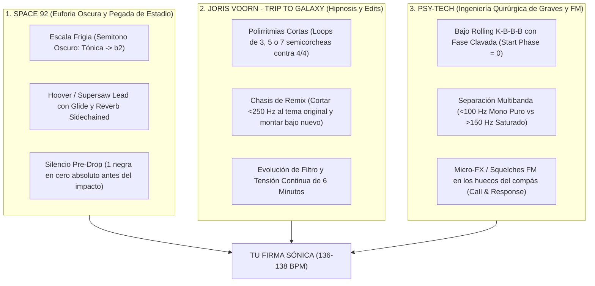
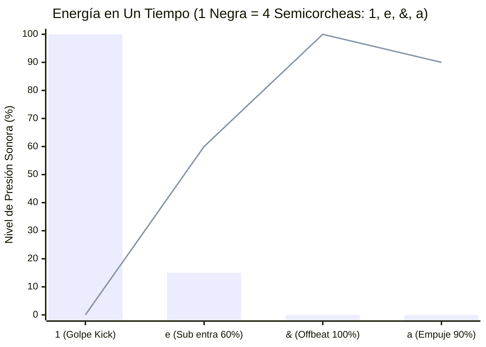
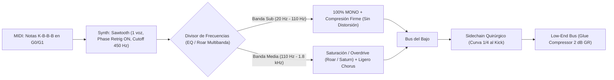
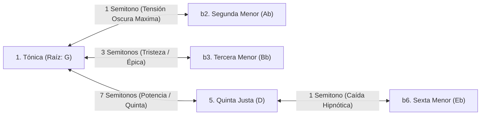
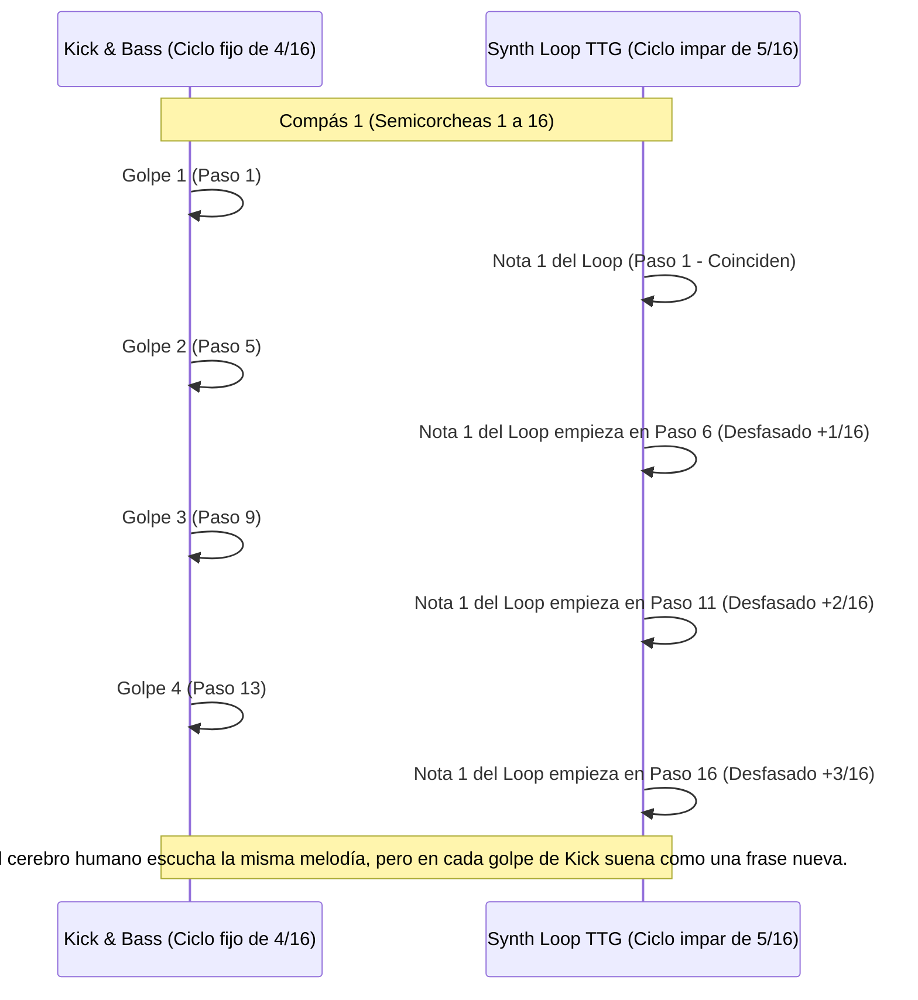
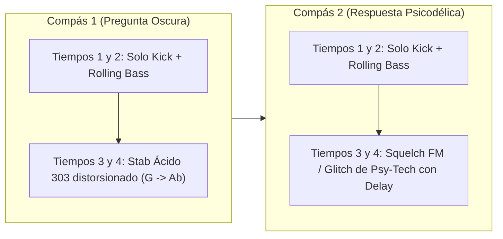
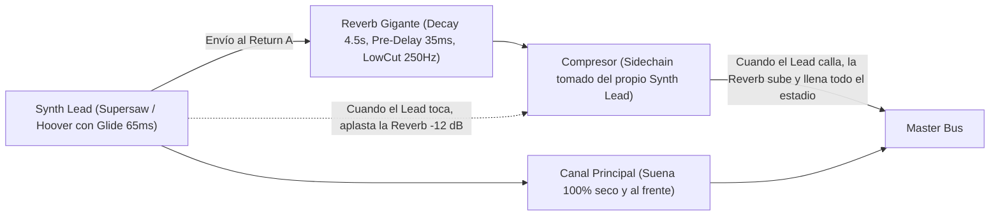
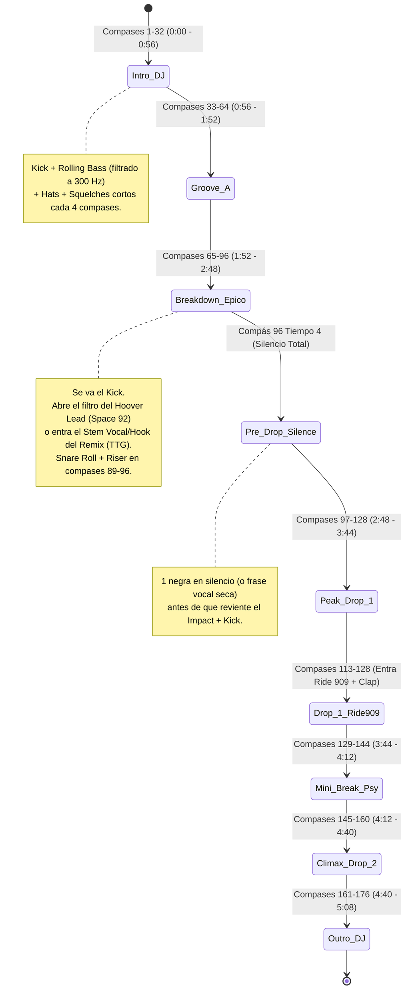
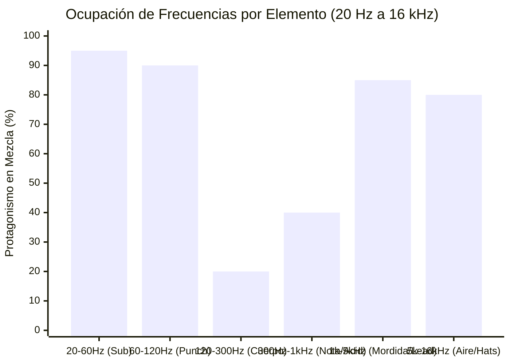

# Blueprint de Ingeniería y Teoría Musical: El Sistema Space 92 × Trip to Galaxy × Psy-Tech

> [!IMPORTANT]
> **El Secreto de una "Firma Sónica" (Sonic Fingerprint):**
> No te convertís en el próximo Space 92 o Joris Voorn cambiando de sintetizadores todos los días. Te convertís en referente cuando **congelás el 80% de tu ingeniería (tu Chasis Fijo)** y solo variás el **20% compositivo (el Gancho, las Notas y el Vocal)** de un tema a otro. Cuando el oído humano reconoce la misma relación física entre tu Kick, tu Sub Rolling y el timbre de tu Lead en los primeros 3 segundos, tu nombre queda grabado.

---

## 1. La Ecuación de los 3 Mundos (Tu Identidad Propia)

Si copiás 100% a Space 92, sos un clon de Space 92. Pero si cruzás **la arquitectura de tensión y leads épicos de Space 92** + **el motor hipnótico/polirrítmico de Joris Voorn (*Trip to Galaxy*)** + **la precisión quirúrgica del bajo y los squelches del Psy-Tech**, tenés un sonido propio que hoy rompe cualquier pista a `136–138 BPM`.



---

## 2. Física del Low-End: Por qué el Bajo de Space 92 y el Psy-Tech "Galopa"

En el techno berlinés tradicional el grave es una nube difusa de reverb (*rumble*). En **Space 92** y en el **Psy-Tech**, el grave es **una línea de sintetizador MIDI milimétrica** que conversa con el Kick en cada negra (`1/4`).

### A. La Grilla de 4 Semicorcheas por Tiempo (`1/16` Grid)
Un compás de `4/4` tiene 4 negras (tiempos), y cada negra se divide en **4 semicorcheas (`1/16`)**: `1 - e - & - a`.

* **Posición `1` (Tiempo fuerte):** Golpea el **Kick** solo. El bajo está silenciado al `100%` por la curva de sidechain (*VolumeShaper*).
* **Posición `e` (2da semicorchea):** Entra la primera nota del bajo (al `50–70%` de volumen porque la cola del kick todavía está bajando).
* **Posición `&` (Offbeat / Contratiempo):** Golpea la nota principal del bajo al `100%` de energía. Es la que te hace cabecear.
* **Posición `a` (4ta semicorchea):** Empuja hacia el próximo Kick, generando el efecto "locomotora" o *rolling*.



> [!TIP]
> **Lectura del gráfico arriba:**
> * Las **barras** son el **Kick**: clava el `100%` del transiente en el `1`, cae al `15%` en `e` y desaparece antes del `&`.
> * La **línea** es el **Rolling Bass (`K-B-B-B`)**: está en `0%` en el `1` (para no cancelar la fase del Kick), sube al `60%` en `e`, explota al `100%` en el `&` y empuja al `90%` en `a`. **Nunca chocan dos graves al mismo tiempo.**

### B. Los 3 Patrones de Bajo que definen el estilo
````carousel
### 1. El Rolling `K-B-B-B` (Psy-Tech & Space 92)
Tres notas de semicorchea (`1/16`) por cada golpe de Kick.
```text
Compás (16 semicorcheas):
Tiempo:  | 1   e   &   a  | 2   e   &   a  | 3   e   &   a  | 4   e   &   a  |
KICK:    | X   .   .   .  | X   .   .   .  | X   .   .   .  | X   .   .   .  |
BASS:    | .   B   B   B  | .   B   B   B  | .   B   B   B  | .   B   B   B  |
Veloc.:  |     75  120 105|     75  120 105|     75  120 105|     75  120 105|
```
* **Clave:** La onda Sawtooth del sintetizador (`Wavetable` / `Operator` / `Serum`) tiene que tener **Phase Random = 0%** (o *Retrig* activado) para que las 3 notas suenen idénticas siempre.
<!-- slide -->
### 2. El Galope en Tresillos `1/8T` (Firma Space 92)
En lugar de dividir el tiempo en 4 semicorcheas, lo dividís en **3 tresillos de corchea**.
```text
Tiempo (Tresillos): | 1    t    l   | 2    t    l   | 3    t    l   | 4    t    l   |
KICK:               | X    .    .   | X    .    .   | X    .    .   | X    .    .   |
BASS (Triplet):     | .    B    B   | .    B    B   | .    B    B   | .    B    B   |
```
* **Efecto psicológico:** Da sensación de marcha épica e hipnótica. Space 92 suele usar `K-B-B-B` en el Drop 1 y pasar a **Tresillos** o **Sub Octavado** en el Drop 2.
<!-- slide -->
### 3. El Polirritmo `3/16` Rolling (Firma Joris Voorn TTG)
Un patrón de **3 semicorcheas** de notas graves (ej. `G1 → G1 → D1`) que se repite sobre la grilla de 4 semicorcheas.
```text
Grilla 1/16: | 1  e  &  a | 2  e  &  a | 3  e  &  a | 4  e  &  a |
KICK:        | X  .  .  . | X  .  .  . | X  .  .  . | X  .  .  . |
ACENTO BASS: | G  g  d  G | g  d  G  g | d  G  g  d | G  g  d  G |
               ^        ^      ^        ^      ^        ^
```
* Como `3` no divide a `16`, el acento del bajo cae en un lugar distinto de cada golpe de Kick y recién vuelve a coincidir cada 3 compases. Eso genera **hipnosis instantánea**.
````

### C. Cadena de Procesamiento Multibanda del Bajo (El Secreto del Brillo sin Barro)



---

## 3. Teoría Armónica: La Escala del "Peligro Épico" (Modo Frigio y Frigio Dominante)

¿Por qué los temas de **Space 92**, **HOLO** o **Psy-Tech** suenan oscuros, tensos y espaciales sin usar acordes complejos de jazz? Porque casi nunca usan la escala mayor ni la menor alegre: usan **el intervalo de segunda menor (`b2`, a 1 solo semitono de la nota raíz)** del **Modo Frigio**.



> [!NOTE]
> **Las 4 únicas notas que necesitás para un himno estilo Space 92 en Sol Frigio (`G Phrygian`):**
> * **`G` (Tónica):** Tu centro de gravedad (donde vive el Kick y el Bajo el 85% del tema).
> * **`Ab` (`+1` semitono):** La nota de "peligro/ácido". Cuando el bajo o el lead tocan `G -> Ab -> G`, el cerebro siente tensión inmediata.
> * **`Bb` (`+3` semitonos) o `B` (`+4` semitonos en Frigio Dominante / Psy):** La nota que abre la euforia en el Breakdown.
> * **`D` (`+7` semitonos) y `Eb` (`+8` semitonos):** La quinta de potencia y su semitono superior (`Eb -> D`), que es el gancho clásico de los leads de Trance/Techno.

---

## 4. El Motor Hipnótico de Joris Voorn (*Trip to Galaxy*): Polirritmia `5 contra 4`

Mientras el Kick y el Bajo clavan una cuadrícula rígida de `4/4` (`16` semicorcheas), Joris Voorn pone arriba un sintetizador (`Meld`, `Drift` o `Wavetable`) cuyo clip MIDI dura **5 semicorcheas (`5/16`)** o **7 semicorcheas (`7/16`)**.



---

## 5. Arquitectura "Call & Response" (Cómo dialogan el Ácido, los Squelches de Psy-Tech y el Lead)

El error más común al empezar es hacer que todos los sintetizadores toquen al mismo tiempo. En **Space 92** y en el **Psy-Tech**, los sonidos se **turnan dentro de un bloque de 2 o 4 compases** (*Pregunta y Respuesta*):



### Cómo lograr que el Lead de Space 92 suene "Gigante pero Limpio" (Ducking Reverb)
Si le ponés una Reverb de 5 segundos a un Lead rápido, se arma una bola de ruido inentendible. Space 92 usa un **Compresor con Sidechain puesto DESPUÉS de la Reverb, escuchando al propio Lead seco**:



---

## 6. Anatomía del Mapa de Arreglo de 6 Minutos y del "TTG Remix"

Tanto un tema original tuyo como un **Remix estilo Trip to Galaxy / Space 92** siguen esta curva de energía en **176 compases (`~5:15 min` a `137 BPM`)**:



### ¿Cómo funciona el "Chasis de Remix" sobre esta misma estructura?
Cuando querés hacer un remix de cualquier tema (un clásico de trance, un tema indie/pop, o un track de house para llevarlo a Psy-Tech / Peak Time):
1. **Separación en 3 Stems:** Aislás del tema original únicamente el **Vocal**, el **Hook/Sinte principal** y la **Atmósfera** (descartás por completo la batería y el bajo viejos).
2. **Warping a `137 BPM` y Transporte a Frigio:** Warpeás los stems en modo `Complex Pro` (`Formants = 100`) y los llevás a la tónica de tu chasis (`G` o `F`).
3. **Filtro Quirúrgico (`EQ Eight`):** Les cortás todo debajo de `220 Hz` (`48 dB/oct`) para que jamás ensucien tu Kick + Rolling Bass.
4. **Dosificación (Regla de Oro de Joris Voorn):** En los compases `1–64` solo tirás *micro-cortes* de 1 sílaba del vocal con `Echo` psicodélico. Recién en el **Breakdown (`65–96`)** dejás cantar el gancho original entero, y en el **Drop (`97–128`)** el gancho queda picado rítmicamente arriba de tu propio bajo rolling y tu Acid Stab.

---

## 7. ElMapa del Espectro: Dónde vive cada sonido para que suene Profesional



* **`20–60 Hz` (Sub Puro, 100% Mono):** Vive la nota fundamental de tu **Rolling Bass** (`G0`/`F0`, `43–49 Hz`) y la cola grave del Kick. Nadie más entra acá.
* **`60–120 Hz` (Pegada de Pecho, Mono):** Vive el golpe seco del **Kick** (`75–95 Hz`) y el primer armónico del bajo.
* **`120–300 Hz` (La Zona Peligrosa del Barro):** Acá se atenúa casi todo (`-3 a -6 dB`). Solo asoma el cuerpo del Snare y la base cálida del Hoover Lead durante el Breakdown (cuando no están ni el Kick ni el Bajo).
* **`300 Hz – 1.2 kHz` (Zona de los Stabs Ácidos y Squelches FM):** Acá conversan en *Call & Response* el **Acid 303** y los **Squelches de Psy-Tech**.
* **`1.2 kHz – 5 kHz` (Zona Reina del oído humano):** Acá brilla el **Hoover / Supersaw Lead** de Space 92, el **Vocal del Remix** y el chasquido del **Clap**.
* **`5 kHz – 16 kHz` (Brillo, Velocidad y Aire):** Acá corren el **Closed Hat**, el **Open Hat de contratempo (`&`)** y el **Ride 909** del segundo drop.

---

## 8. Tu "Kit de Identidad Propia" en Ableton Live 12 Suite (Los 5 Bloques Fijos)

Para construir tu firma reconocible desde el primer tema, armamos **5 pistas madres fijas** en tu plantilla de Ableton Live 12 Suite:

1. **`01-KICK & PSY-BASS CHASSIS`**: Pista de Kick corto + Pista de `Wavetable`/`Operator` con el patrón `K-B-B-B`, división multibanda en `Roar` (`Sub` limpio + `Mid` rugiente) y curva de ducking exacta.
2. **`02-ACID & PSY SQUELCH CALL-RESPONSE`**: Dos pistas hermanas (`Drift` en modo Acid con filtro resonante + `Operator` FM con `Spectral Resonator`) que dialogan en los tiempos `3` y `4` de cada compás.
3. **`03-TTG POLYRHYTHM ENGINE (5/16)`**: Pista de `Meld` con un clip de `5` semicorcheas en escala Frigia que rota hipnóticamente sobre el `4/4`.
4. **`04-SPACE92 HOOVER LEAD + DUCKED REVERB`**: Pista de `Wavetable` en modo *Unison Shimmer (8 voces)* + *Glide 65ms* + Return de Reverb gigante comprimida por el propio Lead.
5. **`05-REMIX STEM DECK (VOCAL & HOOK)`**: Pistas de audio pre-ruteadas con `EQ Eight` (`<220 Hz` cortado), `Auto Filter`, `Shifter` y envíos de transición para tirar cualquier acapella o stem y convertirlo en un *TTG / Space 92 Edit* en 10 minutos.
